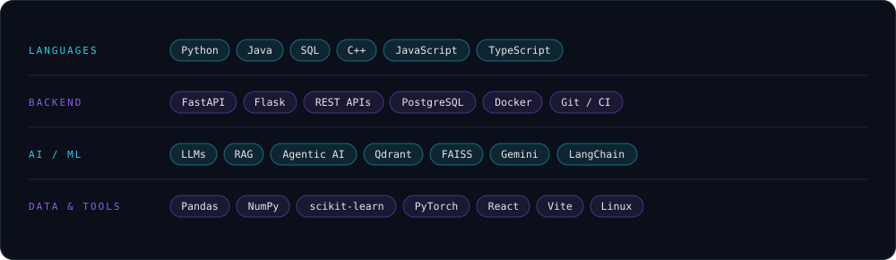

<!--
  CUSTOMIZE: every visual lives in /assets as plain SVG (open in VS Code and edit text/colors).
  Palette: background #0b0f19 · cyan #22d3ee · violet #8b5cf6
  To regenerate cards/hero after changing text, edit assets/*.svg directly.
-->

 

## About

Third-year B.Tech student in AI &amp; ML at VIT-AP, focused on the part of AI that has to work in production: retrieval pipelines, LLM agents, and the backend services around them. I like systems where the model is one component among APIs, vector stores and monitoring, not the whole story.

## Stack

## Selected work

<table align="center">
<tr>
<td></td>
<td></td>
</tr>
<tr>
<td></td>
<td></td>
</tr>
</table>

## Activity

<!-- Snake needs .github/workflows/snake.yml (see HOW-TO-USE.md) -->
<picture>
  <source media="(prefers-color-scheme: light)" srcset="https://raw.githubusercontent.com/k1krrish/k1krrish/output/github-snake.svg" />
  
</picture>

## Currently

| Area | Focus |
|:--|:--|
| LLM applications | Retrieval quality, evaluation, agent tool use |
| Security x AI | Shadow AI detection, explainable risk scoring |
| Backend | FastAPI services, containerized deployment |
| Next | MLOps: deployment and monitoring of model-backed APIs |

 
Open to internships and backend / AI platform roles &#183; <a href="mailto:krrishmantri29@gmail.com">krrishmantri29@gmail.com</a>

